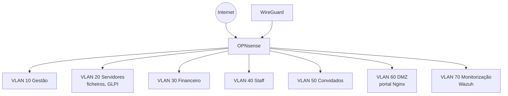

# Homelab: maturidade de cibersegurança numa rede virtualizada

*Virtualized, segmented office network (default-deny firewall, VPN, centralized monitoring, automatic response), used to measure how open source tools raise cybersecurity maturity against the Portuguese QNRCS 2019 and the CNCS Capability Assessment Framework. University project (ESTG, IPVC), built with Hugo Carvalho.*

Infraestrutura virtualizada para um escritório fictício, com segmentação por VLANs, firewall com política de bloqueio por omissão (*default deny*), VPN, monitorização centralizada e resposta automática a varrimentos. Projeto da licenciatura em Engenharia de Redes e Sistemas de Computadores (ESTG, IPVC), feito em dupla com Hugo Carvalho.

**Tecnologias:** Proxmox VE, OPNsense, WireGuard, Tailscale, Wazuh, Samba, GLPI, Nginx, Kea, Unbound. Previstas: NetFlow com coletor open source e Suricata (IDS).

A parte de rede e firewall (OPNsense, VLANs, regras, DNS, DHCP, VPN) é do Samuel, que também fez a monitorização e a resposta automática com o Wazuh. A parte de serviços e utilizadores (Samba, GLPI, scripts de onboarding e offboarding, auditoria de contas) é do Hugo.

## Pergunta do projeto

Que visibilidade temos do tráfego entre VLANs e do acesso remoto por VPN numa pequena organização, e quanto sobe a maturidade de cibersegurança quando fechamos essa lacuna só com ferramentas open source?

A resposta mede-se com os referenciais, não com a opinião de quem construiu: o **QNRCS 2019** e o **Quadro de Avaliação de Capacidades do CNCS** (níveis 1 Inicial, 2 Intermédio, 3 Avançado, cumulativos). Fazemos o perfil atual, definimos o perfil alvo, implementamos, testamos e reavaliamos. O relatório fala em "alinhado com o QNRCS". Não afirmamos conformidade, porque a conformidade formal não foi avaliada. Ver [enquadramento](docs/enquadramento.md).

## Os três pontos cegos

1. **Tráfego permitido entre VLANs** (por exemplo Financeiro e Staff para `ficheiros`, porta 445). A firewall regista sobretudo o que bloqueia. O WannaCry propagou-se por SMB.
2. **Acesso remoto por VPN.** O WireGuard não gera eventos de sessão: não sabemos quem, de onde, quando, nem se a chave foi copiada.
3. **Tráfego dentro da mesma VLAN.** Só a firewall do Proxmox o vê e os registos dela não chegam ao Wazuh.

## Como se prova

| Passo | O que fazemos | Onde está |
|---|---|---|
| 1 | Perfil atual nas 10 subcategorias em foco, com evidência (o "antes", fixado a 1 de dezembro de 2026) | [perfil atual](docs/qnrcs/perfil-atual.md) |
| 2 | Matriz de conformidade: critérios por nível, alvo, camada ou teste que levanta cada nível | [matriz](docs/qnrcs/matriz-conformidade.md) |
| 3 | Seis documentos curtos que o Quadro pede como evidência (políticas e procedimentos) | [documentos](docs/politicas/) |
| 4 | Cinco camadas de implementação, todas a convergir no Wazuh | [enquadramento](docs/enquadramento.md) |
| 5 | Testes T01 a T16 (feitos) e T17 a T23 (planeados), com controlo positivo e repetição | [plano de testes](docs/plano-de-testes.md) |
| 6 | Reavaliação do perfil (o "depois") e limitações assumidas | por fazer (semana 12) |

## Antes e depois

Perfil atual em rascunho até ao congelamento de 1 de dezembro. A coluna "Alcançado" só se preenche depois da bateria final.

| Código | Subcategoria | Atual | Alvo | Alcançado |
|---|---|---|---|---|
| DE.AE-1 | Modelo de referência de fluxos | 1 | 2 | por medir |
| DE.MC-1 | Monitorização para detetar incidentes | 1 a 2 | 2 a 3 | por medir |
| PR.TP-4 | Redes de comunicações protegidas | 2 | 2 (3 viável) | por medir |
| DE.MC-3 | Atividade dos colaboradores | 1 | 2 | por medir |
| DE.MC-7 | Acessos não autorizados | 1 a 2 | 2 | por medir |
| PR.GA-3 | Acessos remotos | 1 | 3 | por medir |
| PR.GA-5 | Integridade das redes | 2 parcial | 3 | por medir |
| ID.GA-3 | Redes e fluxos mapeados | 2 parcial | 3 | por medir |
| DE.AE-3 | Eventos coletados e correlacionados | 1 | 3 | por medir |
| PR.TP-1 | Registos de auditoria | 1 | 3 | por medir |

## Hardware e base

- Lenovo ThinkCentre M720q (i5-8500T, 6 cores, 32 GB de RAM, SSD de 512 GB)
- Proxmox VE 9.2
- Administração do Proxmox só por Tailscale e pela rede de casa, nunca exposto à Internet

## Arquitetura

## Máquinas e serviços

| Máquina | Tipo | Função |
|---|---|---|
| OPNsense | VM | Firewall e router. DHCP (Kea), DNS (Unbound), NTP, NAT, VPN WireGuard. Envia os registos para o Wazuh |
| ficheiros | VM | Samba, só SMB3 na porta 445, quatro partilhas (ti, financeiro, staff, geral) com permissões por grupo |
| glpi | VM | GLPI com MariaDB, só em HTTPS, para pedidos de suporte, com perfis por departamento |
| wazuh | VM | Wazuh 4.14 (servidor, indexador e painel), com agentes em 5 máquinas |
| portal | LXC | Nginx como proxy inverso (*reverse proxy*) na DMZ, com NAT 80/443 vindo do exterior. Só encaminha os caminhos do Self-Service do GLPI e tem firewall do Proxmox |
| Clientes | VM | 4 clientes Debian (Gestão, Financeiro, Staff, Convidados), clonados de um template com agente QEMU e NTP automático |

## Segmentação e acessos

Tudo é bloqueado por omissão (*default deny*). Só passa o que tem regra explícita. O modelo completo está em [modelo de referência de fluxos](docs/politicas/01-modelo-referencia-fluxos.md).

| VLAN | Zona | Regras principais |
|---|---|---|
| 10 | Gestão | Administra tudo (SSH, painéis do OPNsense e do Wazuh, SMB, GLPI). Ninguém inicia ligações para esta zona |
| 20 | Servidores | Sem acesso às outras zonas. Só respostas e envio de registos para o Wazuh (porta 1514) |
| 30 | Financeiro | Partilhas e GLPI, Internet limitada, sem acesso ao Staff |
| 40 | Staff | Partilhas e GLPI, Internet limitada, sem acesso ao Financeiro |
| 50 | Convidados | Só Internet, com DNS público, isolados de tudo o que é interno |
| 60 | DMZ | O portal só fala com o GLPI na 443 e com o DNS do OPNsense. Se for comprometido, não chega a mais nada |
| 70 | Monitorização | O Wazuh só recebe os agentes e o syslog da firewall e quase não inicia ligações para fora |

A VPN WireGuard tem um perfil por departamento, com as mesmas regras da zona respetiva. Cada VM e o contentor do portal têm ainda a firewall do Proxmox com entrada e saída bloqueadas, como segunda camada.

## Deteção e resposta

- Os registos da firewall chegam ao Wazuh, que deteta varrimentos entre zonas e bloqueia a origem durante 5 minutos através da API do OPNsense (a zona de Gestão fica sempre excluída)
- Deteção de força bruta no SSH (regras nativas do Wazuh)
- Monitorização de integridade das partilhas, para apanhar alterações em massa de ficheiros
- Script de auditoria de contas
- Os cenários de teste baseiam-se em incidentes reais (Target, WannaCry, Colonial Pipeline). O plano tem 16 testes feitos (T01 a T16) e 7 novos planeados (T17 a T23)

## Problemas que resolvemos

**DNS por DHCP.** Os clientes não recebiam DNS e o Pi-hole inicial não chegava às outras redes. O DNS passou para o Unbound do OPNsense, com um servidor por zona.

**VPN sem handshake e sem DNS.** A VPN não fazia handshake por causa de uma opção desligada. Depois, o DNS não respondia na interface da VPN porque ela não estava atribuída no Unbound.

**Bloqueios sem registo no Proxmox.** A firewall do Proxmox não registava os bloqueios explícitos, porque só a política por omissão é registada. Foi preciso acrescentar `-log info` às regras.

**Varrimentos que o Wazuh não via.** Os varrimentos de teste morriam na firewall da própria VM e nunca chegavam ao OPNsense. Para provar a segunda camada, a saída da VM foi aberta só durante o teste.

**Regra do Wazuh abafada pelo ruído.** A regra nativa para bloqueios repetidos era abafada pelo ruído da rede exterior. Foi escrita uma regra própria, só para origens internas.

**API do OPNsense com 403.** Faltava um privilégio ao utilizador da API. Além disso, o script tem de fazer o handshake `check_keys` com o Wazuh, senão o mesmo IP seria bloqueado várias vezes.

**Isolamento do Wazuh.** O Wazuh ficou numa VLAN própria, para que um servidor comprometido não consiga alcançar os registos. Dois equipamentos ficaram sem agente de propósito (Convidados e portal), para manter o isolamento.

## Calendário

| Período | Trabalho |
|---|---|
| 23 a 29 nov | Correções, exportação das configurações, perfil atual com evidências, seis documentos |
| 1 dez | Congelamento da linha de base (o "antes"). O que for novo passa a ser registado como alteração |
| 30 nov a 6 dez | Aferição do risco, perfil alvo, lacunas. Camadas 1 e 2 (registos e fluxos) |
| 7 a 13 dez | Camadas 3 e 4 (Suricata e identidade da VPN) |
| 14 a 20 dez | Camada 5 (correlação, painel, playbooks), testes T17 a T23 |
| 4 a 10 jan | Bateria final T01 a T23, reavaliação do perfil e relatório |
| Meados de jan | Apresentação final com demonstração |

## Documentação

- [Enquadramento](docs/enquadramento.md): pergunta, objetivos, referenciais, método e camadas
- [Perfil atual](docs/qnrcs/perfil-atual.md) e [matriz de conformidade](docs/qnrcs/matriz-conformidade.md): a peça central
- [Documentos de política e procedimento](docs/politicas/): fluxos, registos, acesso remoto, alterações, inventário, correlação
- [Arquitetura](docs/arquitetura.md): topologia, zonas, endereçamento e decisões de desenho
- [Regras de firewall](docs/regras-firewall.md): matriz de fluxos e o porquê de cada zona
- [Plano de testes](docs/plano-de-testes.md): testes com estado e evidência
- [Problemas e soluções](docs/problemas.md): sintoma, causa e solução
- [Configuração manual](docs/configuracao-manual.md): passos feitos nas interfaces
- [Configurações](configs/), [scripts](scripts/) e [evidências](evidencias/)

## Nota

Este repositório é público e não inclui passwords, chaves, tokens nem endereços públicos. As limitações conhecidas estão declaradas nos documentos, não escondidas.
