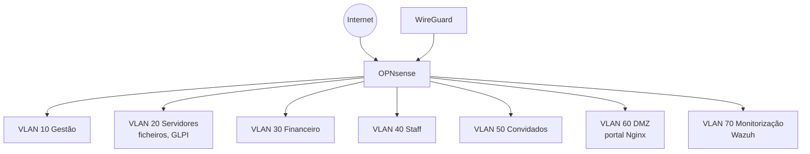

# Homelab: infraestrutura de rede virtualizada e segura

*Virtualized, segmented office network with a default-deny firewall, VPN, centralized monitoring and automatic response to port scans. University project (ESTG, IPVC), built with Hugo Carvalho.*

Infraestrutura virtualizada para um escritório fictício, com segmentação por VLANs, firewall com política de bloqueio por omissão (*default deny*), VPN, monitorização centralizada e resposta automática (*active response*) a varrimentos. Projeto da licenciatura em Engenharia de Redes e Sistemas de Computadores (ESTG, IPVC), feito em dupla com Hugo Carvalho.

**Tecnologias:** Proxmox VE, OPNsense, WireGuard, Tailscale, Wazuh, Samba, GLPI, Nginx, Kea, Unbound.

A parte de rede e firewall (OPNsense, VLANs, regras, DNS, DHCP, VPN) é minha. Nas últimas semanas fiz também a monitorização e a resposta automática com o Wazuh. A parte de serviços e utilizadores (Samba, GLPI, scripts de onboarding e offboarding, auditoria de contas) é do Hugo.

## Hardware e base

- Lenovo ThinkCentre M720q (i5-8500T, 6 cores, 32 GB de RAM, SSD de 512 GB)
- Proxmox VE 9.2
- Administração do Proxmox só por Tailscale e pela rede de casa, nunca exposto à Internet

## Arquitetura

## Máquinas e serviços

| Máquina | Tipo | Função |
|---|---|---|
| OPNsense | VM | Firewall e router. DHCP (Kea), DNS (Unbound), NTP, NAT, VPN WireGuard. Envia os registos para o Wazuh |
| ficheiros | VM | Samba, só SMB3 na porta 445, quatro partilhas (ti, financeiro, staff, geral) com permissões por grupo |
| glpi | VM | GLPI 12 com MariaDB, só em HTTPS, para pedidos de suporte, com perfis por departamento |
| wazuh | VM | Wazuh 4.14 (servidor, indexador e painel), com agentes em 5 máquinas |
| portal | LXC | Nginx como proxy inverso (*reverse proxy*) na DMZ, com NAT 80/443 vindo do exterior |
| Clientes | VM | 4 clientes Debian (Gestão, Financeiro, Staff, Convidados), clonados de um template com agente QEMU e NTP automático |

## Segmentação e acessos

Tudo é bloqueado por omissão (*default deny*). Só passa o que tem regra explícita.

| VLAN | Zona | Regras principais |
|---|---|---|
| 10 | Gestão | Administra tudo (SSH, painéis do OPNsense e do Wazuh, SMB, GLPI). Ninguém inicia ligações para esta zona |
| 20 | Servidores | Sem acesso às outras zonas. Só respostas e envio de registos para o Wazuh (porta 1514) |
| 30 | Financeiro | Partilhas e GLPI, Internet limitada, sem acesso ao Staff |
| 40 | Staff | Partilhas e GLPI, Internet limitada, sem acesso ao Financeiro |
| 50 | Convidados | Só Internet, com DNS público, isolados de tudo o que é interno |
| 60 | DMZ | O portal só fala com o GLPI na 443. Se for comprometido, não chega a mais nada |
| 70 | Monitorização | O Wazuh só recebe os agentes e o syslog da firewall e quase não inicia ligações para fora |

A VPN WireGuard tem um perfil por departamento, com as mesmas regras da zona respetiva. Cada VM tem ainda a firewall do Proxmox com entrada e saída bloqueadas, como segunda camada.

## Deteção e resposta

- Os registos da firewall chegam ao Wazuh, que deteta varrimentos entre zonas e bloqueia a origem durante 5 minutos através da API do OPNsense (a zona de Gestão fica sempre excluída)
- Deteção de força bruta no SSH (regras nativas do Wazuh)
- Monitorização de integridade das partilhas, para apanhar alterações em massa de ficheiros
- Script de auditoria de contas
- Os cenários de teste baseiam-se em incidentes reais (Target, WannaCry, Colonial Pipeline). O plano tem 16 testes: 8 concluídos com evidência, 6 em curso e 2 por fazer

## Problemas que resolvemos

**DNS por DHCP.** Os clientes não recebiam DNS e o Pi-hole inicial não chegava às outras redes. O DNS passou para o Unbound do OPNsense, com um servidor por zona.

**VPN sem handshake e sem DNS.** A VPN não fazia handshake por causa de uma opção desligada. Depois, o DNS não respondia na interface da VPN porque ela não estava atribuída no Unbound.

**Bloqueios sem registo no Proxmox.** A firewall do Proxmox não registava os bloqueios explícitos, porque só a política por omissão é registada. Foi preciso acrescentar `-log info` às regras.

**Varrimentos que o Wazuh não via.** Os varrimentos de teste morriam na firewall da própria VM e nunca chegavam ao OPNsense. Para provar a segunda camada, a saída da VM foi aberta só durante o teste.

**Regra do Wazuh abafada pelo ruído.** A regra nativa para bloqueios repetidos era abafada pelo ruído da rede exterior. Foi escrita uma regra própria, só para origens internas.

**API do OPNsense com 403.** Faltava um privilégio ao utilizador da API. Além disso, o script tem de fazer o handshake `check_keys` com o Wazuh, senão o mesmo IP seria bloqueado várias vezes.

**Isolamento do Wazuh.** O Wazuh ficou numa VLAN própria, para que um servidor comprometido não consiga alcançar os registos. Dois equipamentos ficaram sem agente de propósito (Convidados e portal), para manter o isolamento.

## Em curso (até meados de dezembro)

- Corte da saída dos servidores para a Internet
- Backups com teste de restauro
- 2FA no Proxmox e no GLPI
- Endurecimento de SSH e privilégios (chaves, `sudo`, `auditd`) com regras no Wazuh
- Cenário de ataque completo: cliente comprometido a tentar movimento lateral, com evidências do que é bloqueado e detetado

## Documentação

- [Arquitetura](docs/arquitetura.md): topologia, zonas, endereçamento e decisões de desenho
- [Regras de firewall](docs/regras-firewall.md): matriz de fluxos e o porquê de cada zona
- [Plano de testes](docs/plano-de-testes.md): os 16 testes, com estado e evidência
- [Problemas e soluções](docs/problemas.md): sintoma, causa e solução
- [Configuração manual](docs/configuracao-manual.md): passos feitos nas interfaces
- [Configurações](configs/), [scripts](scripts/) e [evidências](evidencias/)

## Nota

Este repositório não inclui passwords, chaves, tokens nem endereços públicos.
