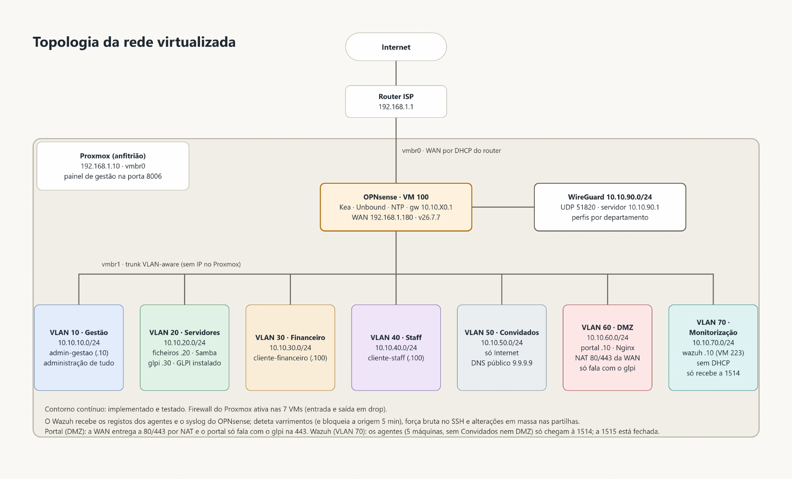

# Arquitetura

Infraestrutura virtualizada para um escritório fictício, a correr num único anfitrião Proxmox. O OPNsense é o único ponto de passagem entre zonas: encaminha, faz NAT, DHCP por VLAN (Kea), DNS (Unbound), NTP, VPN e envia os registos para o Wazuh.

## Zonas e endereçamento

| VLAN | Zona | Sub-rede | Equipamentos |
|---|---|---|---|
| 10 | Gestão | 10.10.10.0/24 | `admin-gestao` (.10, reserva DHCP) |
| 20 | Servidores | 10.10.20.0/24 | `ficheiros` (.20) e `glpi` (.30), IP fixo |
| 30 | Financeiro | 10.10.30.0/24 | `cliente-financeiro` (DHCP) |
| 40 | Staff | 10.10.40.0/24 | `cliente-staff` (DHCP) |
| 50 | Convidados | 10.10.50.0/24 | `cliente-convidado` (DHCP) |
| 60 | DMZ | 10.10.60.0/24 | `portal` (.10) |
| 70 | Monitorização | 10.10.70.0/24 | `wazuh` (.10, IP fixo) |
| VPN | WireGuard | 10.10.90.0/24 | Gestão .10 a .19, Financeiro .30 a .39, Staff .40 a .49 |

O gateway de cada VLAN é o `.1`. O DHCP entrega de `.100` a `.199` nas VLANs com clientes. As VLANs 20 e 70 não têm DHCP. O domínio interno é `escritorio.test`.

## Máquinas

| Máquina | ID | Tipo | Zona | Função | vCPU | RAM |
|---|---|---|---|---|---|---|
| `opnsense` | 100 | VM | Trunk | Firewall, router, DHCP, DNS, NTP, NAT, WireGuard, syslog | 2 | 4 GB |
| `ficheiros` | 221 | VM | Servidores | Samba, só SMB3 na 445, quatro partilhas (ti, financeiro, staff, geral) com permissões por grupo | 1 | 1 GB |
| `glpi` | 222 | VM | Servidores | GLPI 12 com MariaDB, só em HTTPS, perfis por departamento | 2 | 2 GB |
| `wazuh` | 223 | VM | Monitorização | Wazuh 4.14 (servidor, indexador e painel) | 4 | 8 GB |
| `portal` | 230 | LXC | DMZ | Nginx como proxy inverso para o GLPI | 1 | 0,5 GB |
| `admin-gestao` | 211 | VM | Gestão | Cliente Debian de administração | 1 | 2 GB |
| `cliente-financeiro` | 212 | VM | Financeiro | Cliente Debian | 1 | 1 GB |
| `cliente-staff` | 213 | VM | Staff | Cliente Debian | 1 | 1 GB |
| `cliente-convidado` | 214 | VM | Convidados | Cliente Debian | 1 | 1 GB |

As VMs são clones de um template Debian com agente QEMU e NTP automático.

## Base

- Lenovo ThinkCentre M720q (i5-8500T, 6 cores, 32 GB de RAM, SSD de 512 GB)
- Proxmox VE 9.2
- A administração do Proxmox é só por Tailscale e pela rede de casa, com a firewall do Proxmox no anfitrião. Nunca é exposta à Internet.
- Acesso dos utilizadores da organização por WireGuard (UDP 51820), com um perfil por utilizador. O endereço do perfil depende do departamento e determina as regras aplicadas.

## DNS e hora

O DNS é o Unbound do OPNsense, com os nomes internos e reencaminhamento para resolvedores públicos. Cada zona usa o gateway da sua VLAN como DNS e como servidor de hora. Os Convidados usam um resolvedor público e não resolvem nomes internos.

## Camadas de proteção

1. Firewall central (OPNsense) com bloqueio por omissão entre zonas.
2. Firewall do Proxmox em cada VM, com entrada e saída bloqueadas, para que um equipamento da mesma VLAN não seja alcançável sem passar pela firewall central.
3. Wazuh a detetar e a responder, a partir dos registos da firewall e dos agentes.

## Decisões de desenho

- **Wazuh numa VLAN própria.** O Wazuh guarda os registos de todas as zonas. Ao lado dos servidores de serviço, um servidor comprometido ficaria perto do arquivo de provas e as regras de acesso ao Wazuh não poderiam ser mais apertadas do que as dos servidores.
- **Convidados e portal sem agente Wazuh.** Abrir-lhes um caminho para a Monitorização enfraquecia o isolamento. A atividade destes dois vê-se nos registos da firewall. Consequência: a integridade de ficheiros não cobre a configuração do Nginx no `portal`.
- **DNS no Unbound do OPNsense.** Substituiu o Pi-hole inicial, que não chegava às outras redes. É uma máquina a menos num anfitrião com poucos recursos e os nomes ficam num só sítio.
- **Resposta automática pela API do OPNsense.** Um bloqueio no agente seria feito na máquina do atacante. Na firewall central, a origem fica travada para as zonas.

## Limitações assumidas

- **Backups no mesmo anfitrião.** Validam o restauro, mas não protegem contra a falha do disco.
- **VPN sem segundo fator.** A mitigação é uma chave por utilizador, âmbito limitado ao departamento, revogação no offboarding e auditoria de contas inativas.
- **Internet simulada.** O lado externo da DMZ é a rede do computador anfitrião.
- **Ataques simulados.** Os cenários usam varrimentos e tentativas de ligação e de autenticação. Não se executa malware.
- **Falsos positivos.** O bloqueio automático pode afetar um equipamento legítimo. A mitigação é excluir sempre a Gestão e usar bloqueios temporários.
- **Chave da API do OPNsense no Wazuh.** Fica num ficheiro com permissões 640. A chave só pode editar a lista de bloqueio. Se o Wazuh for comprometido, um atacante pode bloquear ou desbloquear endereços.
- **Firewall como ponto único.** Se o OPNsense falhar, as zonas ficam sem rota, sem nomes e sem hora.
- **Armazenamento sobre-alocado.** Os discos virtuais usam volumes finos e a soma excede o espaço físico. O espaço usado é acompanhado.
